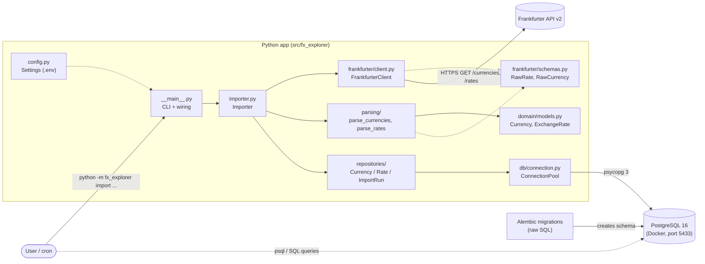
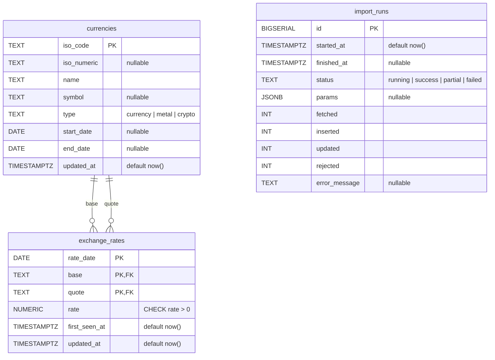
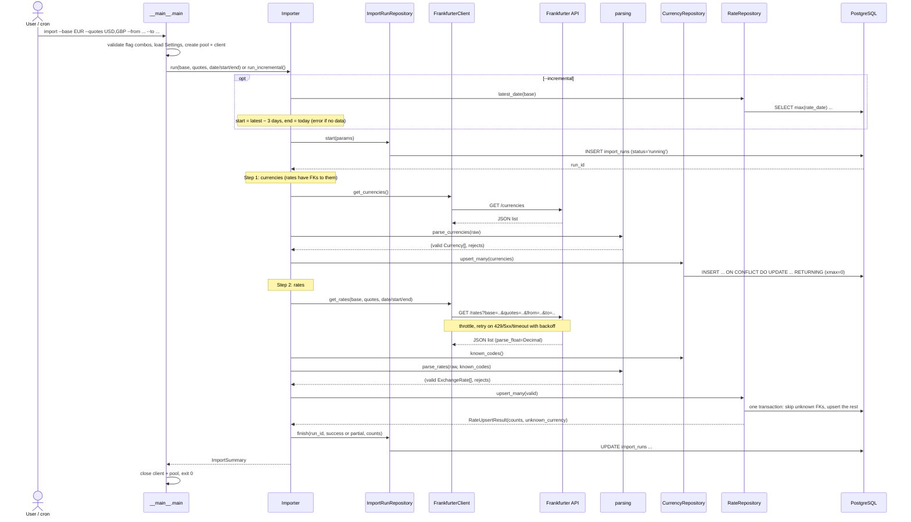
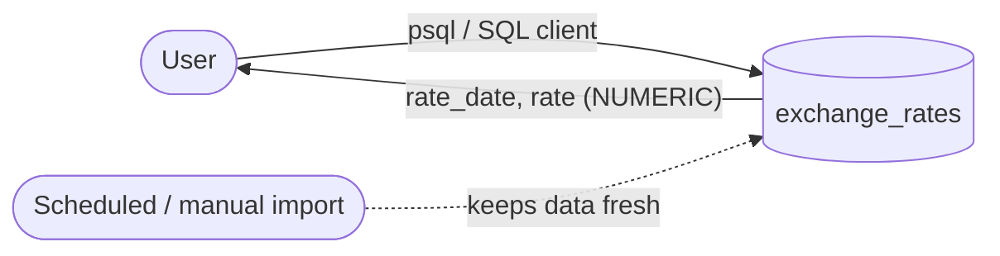
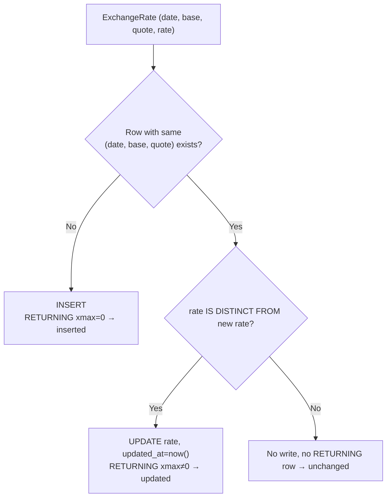

# fx-explorer Architecture

fx-explorer is a Python command-line importer. It downloads currency exchange rates from the [Frankfurter API](https://frankfurter.dev), validates and cleans them, and stores them in PostgreSQL. Re-running an import is always safe.

> **Scope note:** the project has **no frontend and no HTTP API server**. It has three layers: an external API as the source, a Python importer in the middle, and PostgreSQL as the store. Nobody "requests an exchange rate" from this app. Rates are read by querying the database with SQL (see [section 5](#5-main-data-flows)).

---

## 1. Folder / file structure

```
fx-explorer/
├── src/fx_explorer/            Application code (installed as package `fx_explorer`)
│   ├── __main__.py             CLI entry point: argument parsing, wiring, exit codes
│   ├── config.py               Settings loaded from .env / environment (pydantic-settings)
│   ├── importer.py             Orchestrates one import run (no SQL, no HTTP)
│   ├── frankfurter/
│   │   ├── client.py           HTTP client: timeouts, retries, backoff, throttle, error types
│   │   └── schemas.py          Pydantic models of the RAW API shapes (RawRate, RawCurrency)
│   ├── parsing/
│   │   ├── rates.py            Raw rate records -> ExchangeRate; Reject type; shared helpers
│   │   └── currencies.py       Raw currency records -> Currency
│   ├── domain/
│   │   └── models.py           Clean, frozen models: Currency, ExchangeRate
│   ├── repositories/           The ONLY place SQL is written
│   │   ├── currencies.py       CurrencyRepository (upsert, known_codes, count)
│   │   ├── rates.py            RateRepository (upsert, latest_date, count)
│   │   ├── import_runs.py      ImportRunRepository (start, finish, get)
│   │   └── results.py          UpsertCounts (inserted / updated / unchanged)
│   └── db/
│       └── connection.py       create_pool(): psycopg ConnectionPool factory
├── migrations/                 Alembic migrations, written as raw SQL (no ORM)
│   ├── env.py                  Resolves the DB URL, runs online/offline migrations
│   └── versions/001_...py      Creates currencies, exchange_rates, import_runs
├── tests/
│   ├── conftest.py             Test DB safety checks, migrated_db and pool fixtures
│   ├── test_client.py          HTTP client (mocked with respx; fake sleep)
│   ├── test_parsing.py         Parsers / reject rules (pure unit tests)
│   ├── test_repositories.py    Upserts and counts (real PostgreSQL)
│   └── test_importer.py        Importer + CLI (real PostgreSQL, mocked HTTP)
├── docker/init-test-db.sh      Creates the `fx_explorer_test` DB on first volume init
├── docker-compose.yml          PostgreSQL 16 (port 5433 -> 5432), healthcheck, pgdata volume
├── docs/samples/               Saved real Frankfurter responses used to design the schemas
├── alembic.ini                 Alembic configuration
├── pyproject.toml              Dependencies (uv), pytest config
├── .env.example                Template for .env (DB credentials, API and importer settings)
└── README.md                   User-facing setup, usage and data notes
```

### What each part does

| Module | Responsibility | Must **not** |
|---|---|---|
| `__main__.py` | Parse CLI flags, reject invalid combinations, build the object graph, map exceptions to exit codes, close the client and pool | Contain business logic |
| `config.py` | Typed `Settings`, cached by `get_settings()` (`lru_cache`) | |
| `frankfurter/client.py` | Perform HTTP, retry, throttle, return raw JSON as dicts | Touch the DB or validate records |
| `frankfurter/schemas.py` | Describe the API's raw shape (dates stay as text, `rate` is `Decimal`) | Make trust decisions |
| `parsing/*` | Validate and normalise records one at a time and set bad ones aside | Raise on a single bad record |
| `domain/models.py` | Final validated shapes; anything reaching the DB has passed through them | |
| `repositories/*` | All SQL, transactions, and insert/update/unchanged counting | Make HTTP calls |
| `importer.py` | Run the steps in order and record the outcome in `import_runs` | Contain SQL or HTTP details |

---

## 2. Architecture overview

Three tiers: an **external data source**, the **Python importer** (CLI-driven), and **PostgreSQL**. There is no frontend or API layer, and the CLI is the only user interface.



**Layer summary**

- **Source (Frankfurter API v2):** free, no key. Public endpoints `GET /currencies` and `GET /rates` (a single `date`, a `from`/`to` range, or latest).
- **Application:** a layered pipeline. Each layer has one job and only talks to its neighbour: client → parser → repository, coordinated by the importer.
- **Database (PostgreSQL 16):** schema managed by Alembic, accessed via a `psycopg_pool.ConnectionPool` (min 1, max 5). The same server hosts a second DB, `fx_explorer_test`, for the tests.
- **Dependency direction:** `__main__` → `importer` → {`client`, `parsing`, `repositories`}. Parsing depends on `domain` and `frankfurter.schemas`, and repositories depend on `domain` and `db`. The client depends only on `config` and httpx, and the repositories never import the client.

---

## 3. Database schema

Defined in `migrations/versions/001_create_currencies_exchange_rates_import_.py` as plain SQL. There is no ORM.



`import_runs` is standalone. It has no foreign keys to the other tables.

### Tables

**`currencies`**: reference table, loaded first because rates point at it.
- PK: `iso_code`. `type` is constrained to `currency`, `metal` or `crypto`.
- `iso_numeric`, `symbol`, `start_date` and `end_date` are nullable, because many crypto assets have no numeric code and one currency has no symbol.

**`exchange_rates`**: one row per (day, base, quote).
- Composite PK `(rate_date, base, quote)` makes re-imports idempotent at the database level.
- `base` and `quote` are both FKs to `currencies.iso_code`.
- `CHECK (rate > 0)` and `CHECK (base <> quote)`.
- `rate` is `NUMERIC` (never float). `first_seen_at` is set once, and `updated_at` moves only when the rate changes.
- Note: `first_seen_at` and `updated_at` are nullable (no `NOT NULL`), unlike `currencies.updated_at`.

**`import_runs`**: audit log, one row per run.
- Inserted as `running` at start, then updated by `finish()` to `success`, `partial` or `failed` with counts and `error_message`.
- `params` (JSONB) stores the arguments of the run (base, quotes, date, from, to).
- There are no `unchanged` or per-record reject-reason columns. Those exist only in the in-memory `ImportSummary` and the logs.

### Relationships
- `currencies` 1 — N `exchange_rates` through `base`, and again through `quote`.
- No indexes beyond the PKs. `latest_date(base)` runs `max(rate_date) WHERE base = ?`. The PK leads with `rate_date`, so it doesn't serve that filter directly. This is fine for the current data volume.

---

## 4. Key patterns and conventions

1. **Strict layering with single responsibility.** HTTP lives only in the client, SQL only in the repositories, orchestration only in the importer, and each module's docstring states what it does and doesn't do.
2. **Raw → clean → store pipeline.** The API shape is modelled first (`Raw*` schemas, loose: text dates, `extra="ignore"`). Parsers then turn it into strict domain models (`frozen=True`, normalised codes, `rate > 0`, `allow_inf_nan=False`). The DB `CHECK`s act as a last line of defence, and `test_database_rejects_bad_data_directly` verifies them.
3. **"One bad record never stops a run."** Parsers return `(valid, rejects)` tuples. A `Reject(raw, reason)` is logged as a warning and counted, and the run finishes as `partial`. Self-pairs (EUR→EUR) are skipped silently and are *not* rejects.
4. **Idempotent upserts.** `INSERT ... ON CONFLICT (...) DO UPDATE ... WHERE <old> IS DISTINCT FROM <new> RETURNING (xmax = 0)`.
   - A new row is counted as inserted, a changed row as updated, and an identical row is not written at all, so `unchanged = attempted − inserted − updated`.
   - The `xmax = 0` trick is a known PostgreSQL idiom but undocumented as a guarantee, so the integration tests cover it.
   - Each batch is written in one transaction, so a failure leaves no partial data.
5. **Pre-check for foreign keys.** `RateRepository.upsert_many` selects the known currency codes first and skips rates with unknown ones (reported as `unknown_currency`). Otherwise one FK violation would abort the whole batch.
6. **Money is exact.** `json.loads(..., parse_float=Decimal)` in the client, `Decimal` in the models, and `NUMERIC` in Postgres. No `float` anywhere in the path.
7. **Resilient HTTP.**
   - A single lock keeps requests serial, and a throttle enforces `REQUEST_DELAY_SECONDS` between them.
   - Retries cover transport errors, `429` and `5xx`, with exponential backoff `1s, 2s, 4s` plus up to 25% jitter. A `Retry-After` header is honoured and capped at 60 s.
   - Other 4xx responses raise `ApiError` immediately. Exhausted retries raise `RetriesExhaustedError`. Both derive from `FrankfurterError`.
8. **Incremental imports overlap.** Rates are blended and can be revised, so `--incremental` starts at `latest_date(base) − 3 days` (`INCREMENTAL_OVERLAP_DAYS`) and runs to today. With no stored data it raises `NothingToResumeError`.
9. **Failure bookkeeping.** `Importer.run` opens an `import_runs` row first. Any exception marks the run `failed` with `Type: message` and is then re-raised, so the audit log stays complete and the CLI still gets the error.
10. **Manual dependency injection.** There is no DI framework. `__main__.main()` builds the pool, client, repositories and importer, and classes take their collaborators in the constructor. The client takes an injectable `sleep` so tests run instantly.
11. **Config via pydantic-settings.** `.env` values are cached through `get_settings()`. `DEFAULT_QUOTES` accepts a comma-separated string (`NoDecode` plus a validator), and codes are upper-cased.
12. **Migrations are hand-written SQL.** Alembic is used without an ORM (`target_metadata = None`). `env.py` rewrites `postgresql://` to `postgresql+psycopg://`, and a URL set in code (as the tests do) overrides `.env`.
13. **CLI conventions.** Invalid option combinations are rejected up front with `parser.error`. Exit codes are `0` ok, `1` for an API error, and `2` for "nothing to resume" or a usage error.
14. **Testing strategy.**
    - Client and parser tests are network-free (respx and a fake sleep).
    - Integration tests use a real PostgreSQL `fx_explorer_test` database, rebuilt with Alembic (downgrade then upgrade) and `TRUNCATE`d per test.
    - `conftest.py` refuses to run unless the test DB name ends in `_test` and differs from the main DB, and it skips cleanly if the DB is unreachable.
15. **Style.** Type hints throughout (modern `X | None` syntax), frozen dataclasses and models for results, module and SQL comments explaining the *why*, and `logging` (never `print`) except for CLI error output on stderr.

---

## 5. Main data flows

### 5.1 Importing rates (`python -m fx_explorer import ...`)



**Step by step**

1. **CLI** (`__main__.py`) validates the flags and loads settings. `--base` and `--quotes` fall back to `DEFAULT_BASE` and `DEFAULT_QUOTES`.
2. **Run record.** `Importer.run` normalises codes to upper case and inserts an `import_runs` row with status `running`.
3. **Currencies.** Fetch `/currencies`, parse and upsert. This is the reference data the rates depend on.
4. **Rates.** Fetch `/rates` (one day, a range, or the latest). Parse each record against the set of known currency codes, then upsert in a single transaction.
5. **Outcome.** `rejected = parser rejects + unknown-currency skips + currency rejects`. The status is `partial` if `rejected > 0`, otherwise `success`. The counts are written to `import_runs` and returned as an `ImportSummary`.
6. **Failure.** Any exception marks the run `failed` with the error message and is re-raised. The CLI prints `FrankfurterError` and `NothingToResumeError` to stderr and returns exit code 1 or 2.

### 5.2 "What happens when a user requests an exchange rate?"

The application has no request path for this. A user **reads** rates directly from PostgreSQL after an import. Example from the README:

```sql
SELECT rate_date, rate FROM exchange_rates
WHERE base = 'EUR' AND quote = 'NGN' ORDER BY rate_date DESC LIMIT 1;
```



If an API or UI is added later, it should read through a new repository method (SQL stays in `repositories/`) rather than call the Frankfurter client live.

### 5.3 Idempotency flow for one rate row



### 5.4 Incremental import

`--incremental` calls `RateRepository.latest_date(base)`, subtracts 3 days, and imports up to today. Re-fetched days are mostly `unchanged`, and any revised rates are `updated`.

---

## 6. Setup and operations

- **Local infra:** `docker compose up -d` starts PostgreSQL 16 on host port **5433**. On first volume creation, `docker/init-test-db.sh` also creates `fx_explorer_test`.
- **Schema:** `uv run alembic upgrade head`.
- **Run:** `uv run python -m fx_explorer import ...`.
- **Tests:** `uv run pytest`. Integration tests skip if the test DB is unreachable.
- **Stack:** Python ≥3.12 (uv), httpx, pydantic v2, pydantic-settings, psycopg 3 with pool, Alembic (SQLAlchemy is used only as Alembic's driver layer), pytest, respx.
- **Ideas already listed in the README:** scheduled incremental runs, multiple base currencies, a query command or dashboard, anomaly alerts, and persisting reject reasons.
